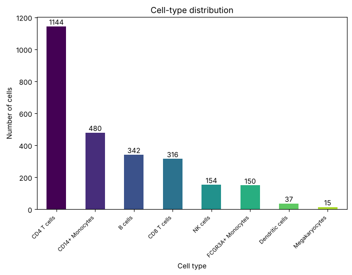
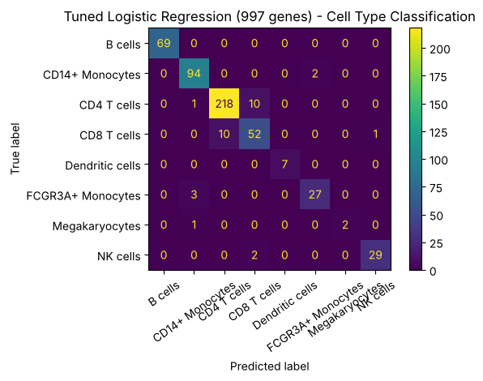
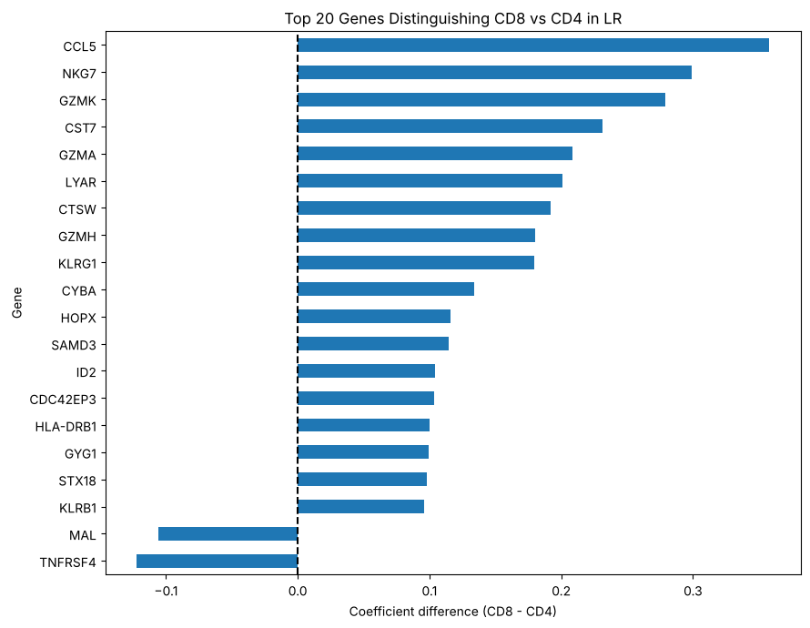
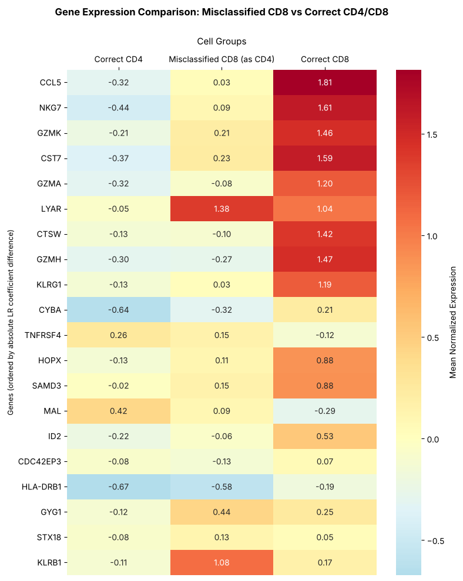
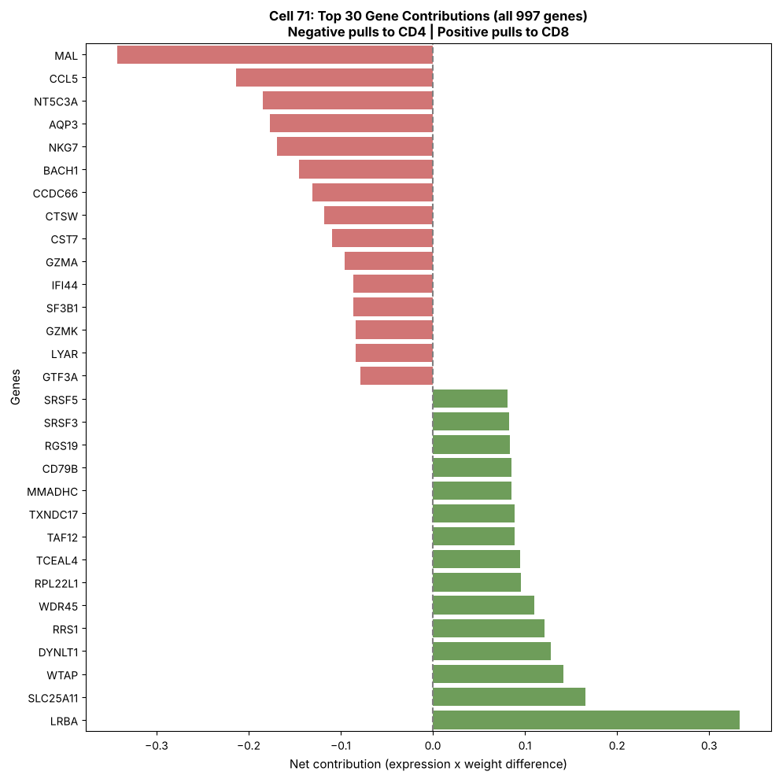
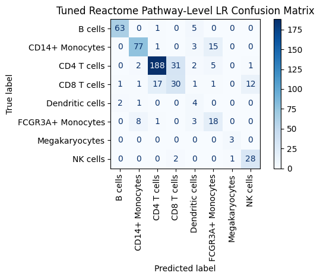

# Classifying Cell Types in Single-Cell Data: Genes vs. Biological Pathways

In this project I used machine learning to predict the cell type of blood cells from their gene expression. Then I asked a second question: what happens if I give the model *biological pathways* instead of single genes?

The full code and explanations are in the notebook: [`Single_cell_ML_project_clean.ipynb`](Single_cell_ML_project_clean.ipynb).

---

## 1. Why I did this project

Single-cell RNA sequencing (scRNA-seq) tells us how active each gene is in each single cell. A typical dataset has thousands of genes per cell, so it is a good playground for machine learning.

Models that use thousands of genes can predict very well, but it is hard to connect their predictions to real biology. So I wanted to answer two questions:

- **RQ1 (gene level):** How well can classical machine learning classify cell types from gene expression?
- **RQ2 (pathway level):** If I replace genes with pathway scores (using Reactome, a database of biological pathways), does the model still work? What do we gain and what do we lose?

## 2. The data

I used the well-known **PBMC 3k** dataset (peripheral blood cells), loaded from `scanpy`:

- 2,638 cells and 1,838 genes
- 8 cell types: CD4 T cells, CD8 T cells, B cells, NK cells, two types of monocytes, dendritic cells and megakaryocytes
- The data were already filtered, normalised and scaled, so I could go straight to modelling

The classes are very unbalanced. CD4 T cells are 1,144 cells, but there are only 15 megakaryocytes.



Because of this, accuracy alone can be misleading. I used **macro F1** as my main metric, because it gives every cell type the same weight, even the rare ones. I split the data into 80% training and 20% test (stratified), and I did all tuning with 5-fold cross-validation on the training set only.

## 3. Part 1: Gene-level classification

### What I did

1. **Feature selection.** I used an ANOVA F-test to keep the 1,000 most informative genes. I put this step inside the cross-validation, so the validation folds never influenced which genes were chosen.
2. **Removing redundancy.** I dropped genes that were very strongly correlated (|r| > 0.8). Only 3 genes were removed, so we ended up with **997 genes**.
3. **Four models.** Logistic Regression, Random Forest, SVM and XGBoost.

### Results

| Model | Test accuracy | Test macro F1 | CD8 recall |
|---|---:|---:|---:|
| **Logistic Regression (tuned)** | **0.943** | **0.925** | 0.825 |
| SVM | 0.941 | 0.920 | 0.794 |
| XGBoost (default settings) | 0.930 | 0.893 | 0.778 |
| Random Forest | 0.917 | 0.858 | 0.635 |

The simple, regularised **Logistic Regression won**. That was a bit of a surprise for me, but it makes sense: we have many features and not so many cells, and a linear model with strong regularisation is hard to overfit. As a bonus, it is also the easiest model to explain.

Also, selecting 1,000 genes worked as well as using all 1,838, so a big part of the genes did not add much for this task.

### The weak spot: CD4 vs. CD8 T cells

Overall accuracy was 94%, which sounds great. But when I looked at the confusion matrix, one problem was clear: **CD4 and CD8 T cells get mixed up**. In the tuned model, 10 CD4 cells were called CD8, and 10 CD8 cells were called CD4.



## 4. Going deeper: why are some CD8 cells misclassified?

I did not want to stop at "the model makes mistakes", so I asked why.

**Is it one bad algorithm?** No. I checked every CD8 cell in the test set: **10 out of 63 (16%) were called CD4 by all four models**. So the problem is in the cells (or in the features), not in a single algorithm.

**Which genes matter?** In Logistic Regression, the difference between the CD8 and CD4 coefficients tells us how much each gene pushes a cell towards CD8 or CD4. The strongest "CD8" genes are cytotoxic genes like `CCL5`, `NKG7`, `GZMK`, `CST7` and `GZMA`. On the CD4 side we find `TNFRSF4` and `MAL`.



**What do the misclassified cells look like?** Their cytotoxic genes are low. For example, `CCL5` is 1.81 in correct CD8 cells, -0.32 in correct CD4 cells, and only 0.03 in the misclassified CD8 cells. So these cells look more like CD4 cells to the model.



**Zooming in on one cell.** I picked cell 71, which the model was most sure about (87% CD4, only 5% CD8). For every gene I calculated its contribution to the decision: expression × (CD8 weight − CD4 weight). I also checked that these contributions plus the intercept add up *exactly* to the model's score, so the explanation is exact for this model.

What I found for cell 71:

- Its cytotoxic genes (`CCL5`, `NKG7`, `CST7`, ...) have low expression, so they push the decision towards CD4.
- Genes like `MAL`, `NT5C3A` and `AQP3` are high and also push towards CD4.
- A few genes (for example `LRBA`) push towards CD8, but not enough.
- No single gene decides. It is the sum of many small contributions.



One important note: this explains **the model**, not the biology. I cannot say these genes *cause* the error.

## 5. Part 2: Pathway-level features

### Idea

Instead of 997 genes, I describe each cell with **30 immune-related Reactome pathways** (like *Interferon Signaling* or *TCR Signaling*). For each pathway, I take the genes that are in my dataset (at least 5 needed) and calculate the **average standardised expression**. Then I train a Logistic Regression on these 30 scores, using exactly the same cells and the same cross-validation as before.

I also tried the 50 Hallmark gene sets first as a quick test. They were weaker (test macro F1 0.62), probably because they are not made for immune cell types. This is why I moved to immune pathways from Reactome.

### Results

| | Gene-level LR | Reactome pathway-level LR |
|---|---:|---:|
| Number of features | 997 | 30 |
| Cross-validation macro F1 | 0.936 | 0.742 |
| Test accuracy | 0.943 | 0.778 |
| Test macro F1 | 0.925 | 0.697 |

The pathway model is clearly worse. It still recognises cell types with a very clear signature well (B cells F1 0.93, NK cells 0.78), but it struggles with similar cells. For example, 31 CD4 T cells were predicted as CD8, 17 CD8 cells as CD4, and 12 more CD8 cells as NK cells. The two monocyte types were also mixed up.



### Why is it worse? (my interpretation)

I want to be careful here, because I did not test every possible reason. These are the explanations I think are likely:

- **Information loss.** An average gives all genes in a pathway the same weight. But genes in the same pathway can behave very differently. Mathematically, the pathway model is a restricted version of the gene model (a linear model with the same weight for all genes of a pathway), so it cannot use gene-specific differences.
- **Low gene coverage.** My dataset only has highly variable genes, so on average only about 17% of each pathway's genes are available.
- **Other factors.** My pathway selection was keyword-based, some pathways overlap (parent and child pathways), and 30 features is much less than 997.

I cannot say how much each of these matters. Testing them one by one would be a good next step.

## 6. Is the pathway model more interpretable?

This was my main hope, and my honest answer is: **not automatically**. Pathways have biological names, which sounds nice. But my score is just a simple average. It does not know about activation, inhibition, or which genes are more important inside a pathway. I also did not test if people can explain pathway predictions better than gene predictions. So I see this as a first exploration, not as a finished interpretable model.

## 7. What I learned

- A strong baseline matters. A simple, regularised linear model beat trees and was easier to explain.
- Always look at the errors, not only the accuracy. 94% accuracy hid a clear CD4/CD8 problem.
- Adding biological knowledge to the features does not automatically improve performance or interpretability. You have to design it carefully.
- This made me want to explore models that use biological structure (pathways, interaction networks) *inside* the model design, not only for explaining it afterwards.

## 8. Limitations

- One small dataset (PBMC 3k). I did not test on independent data.
- There is no donor information. If cells from the same donor are in both training and test sets, the results can look better than they really are.
- The rare classes are tiny in the test set (3 megakaryocytes, 7 dendritic cells), so their scores and the macro F1 are noisy.
- Only simple mean-based pathway scores. Rank-based methods (like AUCell) could give different results.
- In the gene-level part, the later models used genes selected once on the full training set (not inside each fold). The first grid search, which did the selection inside the folds, gave almost the same score (0.937 vs 0.936), so I think the effect is small. The test set was never used for selection.

## 9. How to run it

```bash
pip install scanpy scikit-learn pandas numpy matplotlib seaborn xgboost gseapy
jupyter notebook Single_cell_ML_project_clean.ipynb
```

The pathway part downloads the gene sets from Enrichr through `gseapy`, so you need an internet connection. The dataset is downloaded automatically by `scanpy`.

**Tools:** Python, scanpy, scikit-learn, XGBoost, gseapy, pandas, seaborn.
